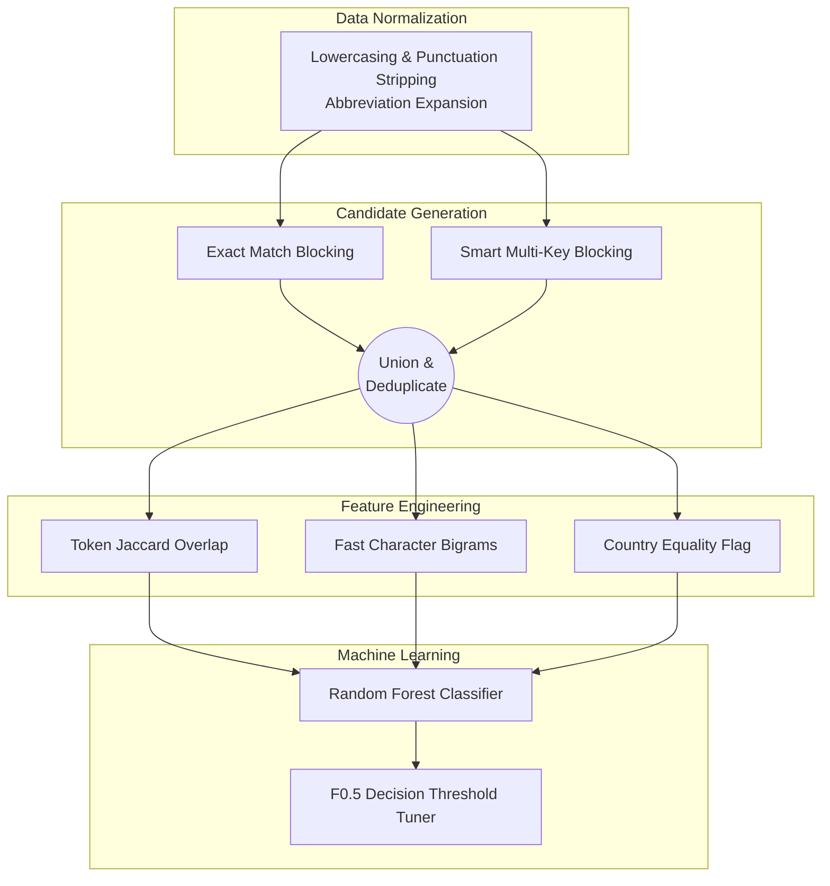

# Business Entity Resolution Pipeline

This repository contains an end-to-end Machine Learning backend for the Amazon ML Challenge: Business Entity Resolution task. It resolves businesses from a deduplicated Source 1 against noisy databases in Source 2 and Source 3.

## System Architecture



## Backend Pipeline Flow & Technical Details

This pipeline was engineered to maximize the **F0.5 Score** (which heavily penalizes false-positive merges) while safely processing hundreds of millions of combinations in memory.

### 1. Ingestion & Normalization
* **Logic**: Loads multi-GB TSV files utilizing heavily optimized Pandas chunks. 
* **Normalization**: Applies vector-based lowercasing, regex punctuation stripping, and standardizes common abbreviations (e.g., `st -> street`, `blvd -> boulevard`) to increase baseline string similarity.

### 2. Candidate Generation (Blocking)
Doing a raw cross-join across 3 sources creates a memory-crashing Cartesian explosion $O(N \times M)$. To bypass this, we utilize a two-pronged blocking strategy to build a high-recall candidate set:
* **Rule A (Exact Match)**: Joins strictly on `Name == Name AND Address == Address`.
* **Rule B (Smart Multi-Key)**: Blocks on a composite key of `Country + First 4 Name Characters + First Address Token`. This acts as a net to catch suffix typos or missing middle words without generating billions of pairs for common words like "The" or "Amazon".
* **Deduplication**: Candidates from both blocks are unioned, and duplicates are dropped.

### 3. Feature Engineering
Standard text similarity libraries (like Python's `difflib.SequenceMatcher`) evaluate at ~$O(K^2)$ per string pair, taking ~45+ minutes on 1.5GB datasets.
* **Vectorized Heuristics**: To optimize this, the backend completely bypasses slow standard libraries. It calculates a **Character Bigram Overlap** (acting as a fast proxy for Levenshtein distance) and a **Token Jaccard Similarity** using native Python Set intersections, reducing feature extraction time to mere seconds.

### 4. Model & Decision Layer
* **Hard Negative Mining**: The `RandomForestClassifier` is trained specifically on "Hard Negatives"—candidate pairs generated by our blockers that are *not* present in the ground truth. This forces the tree nodes to learn fine boundary distinctions rather than trivial random pairs.
* **F0.5 Threshold Optimization**: Random Forests output a probability between `0.0` and `1.0`. Instead of using a default `0.5` cut-off, the pipeline holds out 20% of the Source 1 entities for validation. It systematically scans 81 different threshold breakpoints, scoring each one using a macro-averaged F0.5 calculation. The threshold that mathematically maximizes the F0.5 score is chosen dynamically before generating predictions.

## Execution

1. Place your TSV files in the `data/train/` and `data/test/` folders.
2. Install dependencies: `pip install -r requirements.txt`
3. Run the pipeline: `python src/pipeline.py`

Outputs will be correctly formatted handling Singletons and duplicate removals, ready for submission in `output/`.

## Evaluation Results

The pipeline creates a validation split from 20% of the training Source 1 entities. It prints the following metrics after training:

```text
Validation metrics: accuracy=..., precision=..., recall=..., F1=..., F0.5=...
```

Use the values printed by this run in a project report or LinkedIn post. Report them as **validation metrics**, since the test files do not include public labels.

For this challenge, **F0.5 is the primary metric** because it gives more weight to precision and penalizes incorrect business merges. Accuracy is a secondary pair-level metric and should not be presented as the overall challenge score.

The repository also includes a sample benchmark under `benchmarks/` showing candidate-generation and feature-generation timing. Those runtime measurements are separate from model quality metrics.
